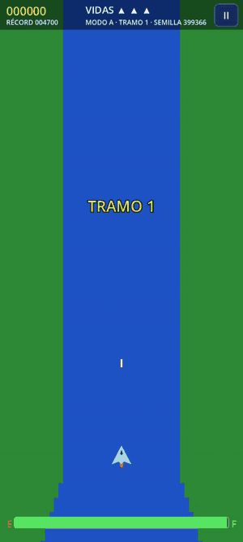
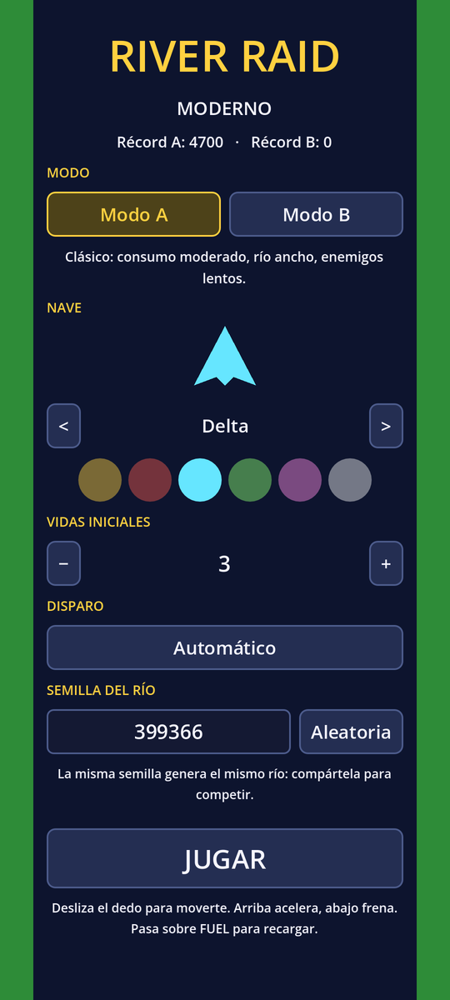
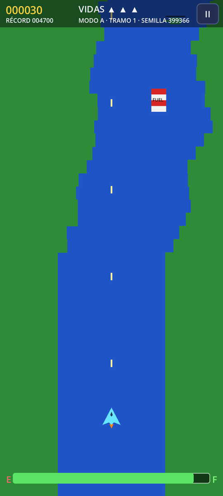
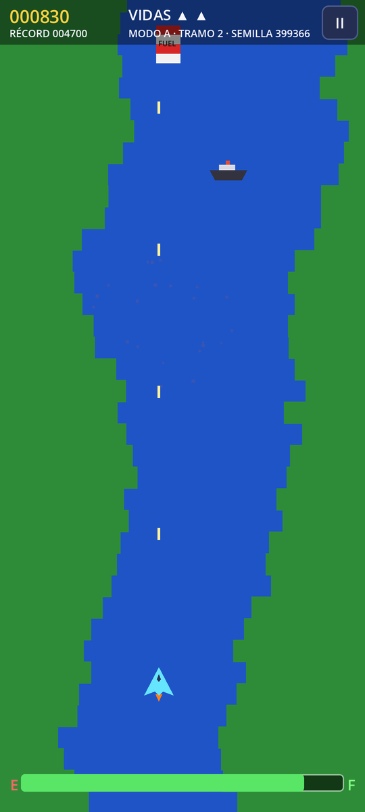
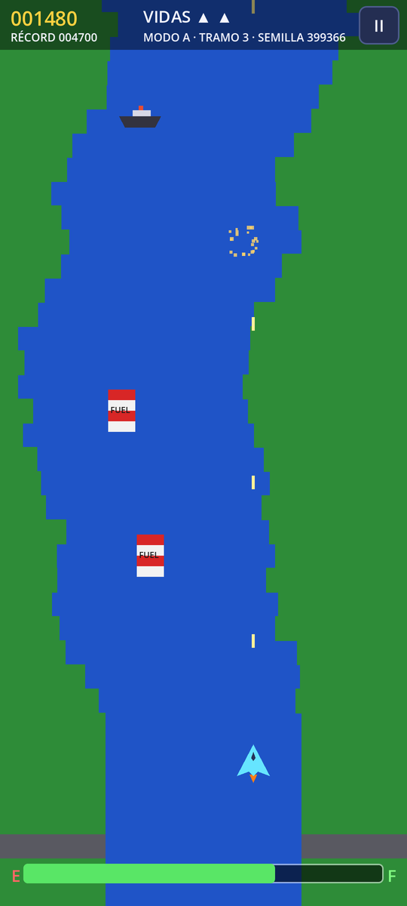
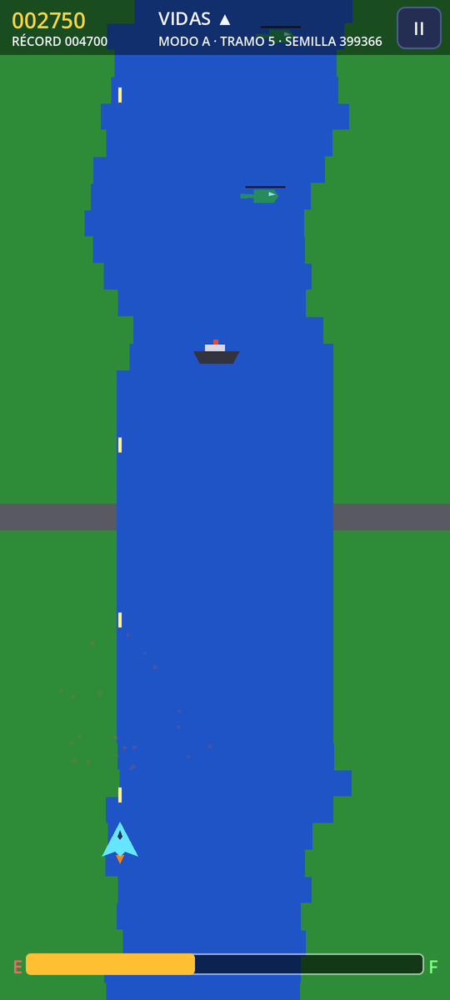

# River Raid Moderno

[](https://github.com/jsanhuezamolina-ai/game_river_raid/actions/workflows/ci.yml)
[](https://github.com/jsanhuezamolina-ai/game_river_raid/releases/latest)


Shooter vertical para Android inspirado en *River Raid* (Atari 2600), rediseñado para pantallas
táctiles. Vuela río arriba, derriba barcos y helicópteros, destruye los puentes y no te quedes sin
combustible.

<p align="center">
  
</p>

<p align="center">
  <a href="docs/media/demo.mp4"><b>▶ Ver el video completo (42 s)</b></a> ·
  <a href="https://github.com/jsanhuezamolina-ai/game_river_raid/releases/latest"><b>⬇ Descargar el APK</b></a>
</p>

## Capturas

| Menú | Tramo 1 | Tramo 2 | Tramo 3 | Tramo 5 |
|:---:|:---:|:---:|:---:|:---:|
|  |  |  |  |  |

## Compatibilidad con Android

| Requisito | Valor |
|---|---|
| **Versión mínima** | **Android 7.0 Nougat** (API 24) |
| **Versión objetivo** | **Android 16** (API 36) |
| Gráficos | OpenGL ES 3.0 o superior (renderer Compatibility de Godot) |
| Procesadores (APK de teléfono) | `arm64-v8a` y `armeabi-v7a`: la gran mayoría de teléfonos y tablets |
| Procesadores (APK de emulador) | `x86` y `x86_64` |
| Pantalla | Vertical. Se adapta a pantallas altas (20:9 y similares) |
| Permisos | Ninguno |

**Dónde se probó:**

| Dispositivo | Android | Resultado |
|---|---|---|
| Emulador Pixel 6 (x86_64) | 14 (API 34) | ✅ Se jugó completo: menú, partida, recarga, puentes y fin del juego |
| Emulador Android TV (x86) | 16 (API 36) | ⚠️ Abre y funciona, pero no está pensado para TV (sin pantalla táctil y en horizontal) |
| **Redmi 15C** (arm64, Mali-G52) | **16 (API 36)** | ✅ Instalado y jugado: menú legible en 720×1600, sin errores en los registros |

## Cómo se juega

| Acción | Táctil | Teclado (PC) |
|---|---|---|
| Moverse | Desliza el dedo en **cualquier parte** de la pantalla | ← → |
| Acelerar / frenar | Desliza hacia arriba / abajo | ↑ / ↓ |
| Disparar | Automático (en modo manual, toca la pantalla) | Espacio (modo manual) |
| Pausa | Botón **II** o botón Atrás de Android | Esc |

- **Combustible:** se gasta más rápido a mayor velocidad. Vuela por encima de los tanques **FUEL** para recargar; los misiles los atraviesan sin destruirlos.
- **Muertes:** chocar con la orilla, una isla, un enemigo o un disparo enemigo, o quedarse sin combustible. Al reaparecer tienes 2 segundos de invulnerabilidad.
- **Puentes:** cierran cada tramo. Destrúyelos para avanzar; el río se estrecha un poco en el siguiente.
- **Puntos:** barco 30 · helicóptero 60 · puente 500.

## Características

- **Modo A (clásico):** consumo moderado, río ancho y enemigos lentos.
- **Modo B (veterano):** casi el doble de consumo, río estrecho, enemigos rápidos y la mitad dispara.
- **Río procedural infinito por semilla:** la misma semilla genera siempre el mismo río (curvas, islas, enemigos, tanques y puentes). Compártela para competir en igualdad.
- **Personalización:** 3 modelos de nave (Clásico, Delta, Bombardero), 6 colores, vidas de 1 a 5 y disparo automático o manual.
- **Sonido retro** sintetizado en el propio juego, sin archivos de audio de terceros.
- **Récord por modo** y última configuración guardados en el teléfono.
- **Pausa automática** al salir de la app.
- **Sin anuncios, sin conexión a internet y sin permisos.**

## Instalación

### En un teléfono
> **Xiaomi / Redmi / POCO:** si `adb install` falla con `INSTALL_FAILED_USER_RESTRICTED`, activa
> **Opciones de desarrollador → Instalar vía USB**, o copia el APK a Descargas e instálalo desde el
> Administrador de archivos.

1. Descarga `river_raid_debug.apk` desde [Releases](https://github.com/jsanhuezamolina-ai/game_river_raid/releases/latest).
2. Ábrelo en el teléfono y permite **instalar apps de origen desconocido** cuando lo pida.

También puedes instalarlo por USB, con la depuración USB activada:
```bash
adb install -r river_raid_debug.apk
```

### En un emulador de Android Studio
Usa `river_raid_x86_debug.apk`, también disponible en Releases. Se recomienda una imagen de **teléfono** x86_64 con Android 14:
```bash
adb install -r river_raid_x86_debug.apk
```
En el emulador, el mouse funciona como el dedo: mantén presionado y arrastra.

## Desarrollo

### Requisitos
- [Godot 4.7.2](https://godotengine.org/download) con las plantillas de exportación de la misma versión.
- Para exportar a Android: Android SDK (build-tools y platform-tools), JDK 17 o superior y una keystore de depuración. Las rutas se configuran en **Editor → Configuración del editor → Exportar → Android**.

### Abrir y ejecutar
```bash
godot -e .    # abrir en el editor
godot .       # jugar en PC (el mouse simula el dedo)
```

### Prueba automática
El juego incluye un piloto automático que juega solo y muestra estadísticas en la consola. Es el mismo que usa el CI:
```bash
godot --headless --path . -- --autoplay --autoplay-seconds=40 --mode=B --seed=12345
godot --headless --path . -- --autoplay --seek-fuel --mode=A   # sin disparar; busca los tanques
```

| Argumento | Uso |
|---|---|
| `--autoplay` | Salta el menú y juega solo |
| `--autoplay-seconds=N` | Duración de la prueba |
| `--mode=A\|B` · `--seed=N` | Modo y semilla del río |
| `--seek-fuel` | No dispara y vuela hacia los tanques (prueba de recarga) |
| `--screenshot=ruta.png` | Guarda una captura a los 6 s (requiere ventana) |

### Exportar los APK
```bash
godot --headless --path . --export-debug "Android" build/river_raid_debug.apk
godot --headless --path . --export-debug "Android x86 (emulador)" build/river_raid_x86_debug.apk
```

### Estructura
```
project.godot            540×960 vertical, renderer Compatibility, capas de colisión
export_presets.cfg       Preajustes "Android" (ARM) y "Android x86 (emulador)"
scenes/                  Menu, Main, Player, Bullet, Enemy, FuelDepot
scripts/
  game_state.gd          Autoload: configuración, modos, naves y récords (user://river_raid.cfg)
  sfx.gd                 Autoload: efectos de sonido sintetizados (AudioStreamWAV)
  ui.gd                  Tema visual y componentes de interfaz
  menu.gd                Menú inicial
  main.gd                Partida: HUD, vidas, pausa, fin del juego y piloto automático
  river_generator.gd     Río por semilla: orillas, islas, puentes y objetos
  player.gd              Control táctil, velocidad, combustible y disparo
  enemy.gd               Barco, helicóptero, puente y disparo enemigo
  fuel_depot.gd          Tanque de combustible
  bullet.gd              Misil del jugador
docs/
  media/                    Capturas, GIF y video de demostración
```

**Capas de colisión:** 1 Jugador · 2 ParedesRio · 3 Enemigos · 4 Combustible · 5 Proyectiles.

Las escenas `.tscn` son mínimas: cada script construye sus nodos en `_ready()`, así toda la lógica y el dibujo quedan en código fácil de revisar.

## Notas
- Los APK publicados son de **depuración** (firmados con la keystore de depuración) y pesan unos 55 MB, porque incluyen el motor para dos arquitecturas. Para publicar en Google Play hace falta una keystore propia y exportar en modo *release* (AAB).
- Paquete: `com.jonathan.riverraid` · Versión 1.0.0 (código 1).
- Cambios: ver [CHANGELOG.md](CHANGELOG.md).

## Licencia

Pendiente de definir por el autor. *River Raid* es una marca de Activision; este proyecto es un homenaje sin afiliación y no usa recursos del juego original.
